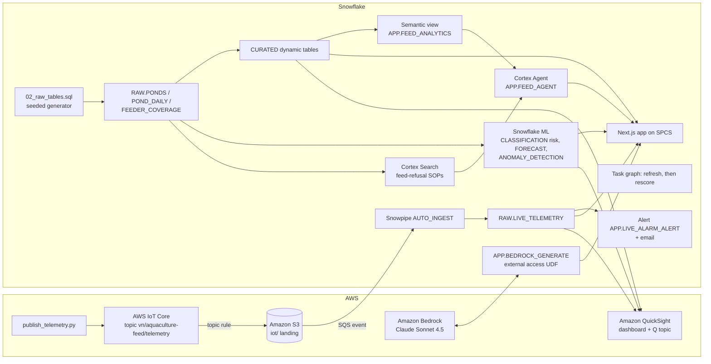

# Vietnam Aquaculture Feed - Pond Feeding Operations

Pond-level feed management for a **fictional Vietnamese aquaculture grower with 30 synthetic ponds near Can Tho, Long Xuyen, Ca Mau and Soc Trang**, farming pangasius, whiteleg shrimp, black tiger shrimp, tilapia and giant freshwater prawn. It is built on Snowflake with an optional AWS edge. A pond feeding-sensor alarm becomes a 7-day feed-refusal risk score, an email to the feed technician and an AI-drafted action memo. The grower, ponds, people and figures are invented; nothing here describes the production, feed use or compliance of any real company or farm.

## Architecture

The Snowflake core uses Dynamic Tables, Snowflake ML, Cortex Search, a Cortex Agent, Cortex AI_COMPLETE and SPCS; the full build adds **AWS** IoT Core, S3, Bedrock Claude and QuickSight with Amazon Q. Pond feeding-sensor readings land in `RAW.LIVE_TELEMETRY`. Dynamic tables curate 90 days of pond-day history into feed uptake rate, feed-refusal events, feed dispensed, feed efficiency, low-oxygen alerts, auto-feeder uptime and auto-feeder coverage. Snowflake ML ranks ponds by 7-day feed-refusal risk, forecasts the grower's daily feed demand and flags unusual uneaten-feed days. The Cortex Agent answers with SQL and SOP citations, and an LLM drafts the action memo for the feed operations team.

Interactive diagrams (hover for object names): [Snowflake only](docs/architecture-snowflake.html) | [AWS + Snowflake](docs/architecture-aws.html). The app shows both on its Architecture & Data tab, the current build first. Regenerate them with `python3 docs/build_architecture.py`.



The Snowflake-only build drops the AWS subgraph: `APP.SIMULATE_TELEMETRY` writes to `RAW.LIVE_TELEMETRY`, and the app calls Cortex `AI_COMPLETE` instead of the Bedrock UDF.

## Snowflake Capabilities

| Capability | Implementation |
|-----------|---------------|
| Dynamic Tables | `CURATED.KPI_SUMMARY`, `PERFORMANCE_SUMMARY`, `FEED_REFUSAL_CAUSES`, `TREND_ANALYSIS` from the RAW tables |
| Snowflake ML | CLASSIFICATION 7-day feed-refusal risk (`ML.FEED_REFUSAL_RISK_SCORES`), 14-day feed demand FORECAST, uneaten feed ANOMALY_DETECTION |
| Cortex Search | 20 synthetic feed-refusal response SOPs (one per species and cause) in `SEARCH.FEED_SOP_SEARCH` |
| Semantic View | `APP.FEED_ANALYTICS` over ponds, feed-refusal causes, daily totals and risk |
| Cortex Agent | `APP.FEED_AGENT`: Cortex Analyst over the semantic view plus Cortex Search for SOP citations |
| Cortex AI | `AI_COMPLETE('claude-sonnet-4-5')` for grounded answers, and for the action memo in the Snowflake-only build |
| Alerts + Tasks | `APP.LIVE_ALARM_ALERT` logs ALARM readings and sends email; task graph `TASK_REFRESH_CURATED`, then `TASK_RESCORE_RISK` |
| Snowpark Container Services | Next.js app `APP.VN_AQUACULTURE_FEED_APP` with 6 tabs: Executive Cockpit, Predictive, Pond Feeding, Live IoT, Ask AI, Architecture & Data |
| Snowpipe | `RAW.LIVE_TELEMETRY_PIPE` AUTO_INGEST from S3 (AWS build only) |

## AWS Services

Used only in the AWS + Snowflake build.

| Service | Role in Demo |
|---------|-------------|
| AWS IoT Core | Receives simulated pond feeding-sensor telemetry (uneaten feed, auto-feeder hopper level). A topic rule writes each message to S3 |
| Amazon S3 | Landing bucket. An event notification goes to the Snowpipe SQS queue |
| Amazon Bedrock | Claude Sonnet 4.5 writes the action memo, called from Snowflake through an external-access UDF |
| Amazon QuickSight | DIRECT_QUERY executive dashboard over Snowflake (daily feed uptake rate, feed-refusal events by pond, feed-refusal risk) |
| Amazon Q | Natural-language questions over the QuickSight topic `vn-aquaculture-feed-topic` |
| AWS IAM | Least-privilege roles for S3, IoT and Bedrock |

## Personas

Both personas are fictional.

| Persona | Role | Key Questions |
|---------|------|---------------|
| **Tran Minh Chau** | Head of Feed Operations | "Which city trails on feed uptake rate?" "Which feed-refusal causes leave the most feed trays uncleared?" |
| **Le Van Phuc** | Pond Feed Technician | "Which ponds carry high feed-refusal risk this week, and which SOP do I follow?" |

## Data

Every row is synthetic and HASH-seeded, so a rebuild reproduces it exactly. Grower and pond names are invented; Can Tho, Long Xuyen, Ca Mau and Soc Trang are real Vietnamese cities used only as region labels. Rations, feed efficiency and thresholds are demo settings rather than aquaculture standards, and no figure is a feeding recommendation.

| Table | Rows | Description |
|-------|------|-------------|
| RAW.PONDS | 30 | Ponds near 4 cities, farming 5 species (Pangasius, Whiteleg Shrimp, Black Tiger Shrimp, Tilapia, Giant Freshwater Prawn), with area and pond age |
| RAW.POND_DAILY | 2,700 | Daily pond observations over 90 days: feed trays checked and cleared, feed dispensed, biomass gain, low-oxygen alerts, feed-refusal events, root cause, ration reviews, auto-feeder downtime, uneaten feed and hopper level |
| RAW.FEEDER_COVERAGE | 30 | Pond hectares and hectares served by auto-feeders |
| SEARCH.FEED_SOP_DOCS | 20 | Synthetic feed-refusal response SOPs indexed for Cortex Search |
| RAW.LIVE_TELEMETRY | Grows during the demo | Live readings from IoT Core (AWS build) or `APP.SIMULATE_TELEMETRY` (Snowflake-only build) |
| ML.FEED_REFUSAL_RISK_SCORES | 30 | 7-day feed-refusal probability and risk band per pond |

## Build Instructions

### Prerequisites
- Snowflake account with ACCOUNTADMIN access, and Cortex AI enabled (AI_COMPLETE, Search, Agent).
- An X-Small warehouse with auto-suspend at or below 120 s, and an existing SPCS compute pool.
- Python 3.11+, `snowflake-connector-python`, Node.js 22+, Docker and the `snow` CLI.
- App image: run `snow spcs image-registry login`, then build and push `vn-aquaculture-feed-app:v1` to the database's `APP.IMAGES` repository (see the header of `snowflake/07_deploy_app.sql`).
- AWS build only: `boto3`, AWS credentials for the target account (us-west-2) with Bedrock access, and QuickSight Enterprise.

### SPCS App
```
<DATABASE>.APP.VN_AQUACULTURE_FEED_APP
```

### Tests
```bash
python -m pytest aws snowflake quicksight
```

For a local run, put `SNOWFLAKE_ACCOUNT`, `SNOWFLAKE_USER`, `SNOWFLAKE_DATABASE`, `SNOWFLAKE_WAREHOUSE`, `SNOWFLAKE_AUTHENTICATOR=PROGRAMMATIC_ACCESS_TOKEN`, `SNOWFLAKE_TOKEN` and `DEMO_PLATFORM` in the environment, then run `npm --prefix app run build && npm --prefix app start`.

## Build Modes

Both modes share the same core. They differ in three places, and the app's `DEMO_PLATFORM` setting (in its SPCS spec) switches the memo provider and the Live IoT tab.

| Layer | Snowflake Only | Full AWS + Snowflake |
|---|---|---|
| Live telemetry | `CALL APP.SIMULATE_TELEMETRY(n)` inserts simulated readings into `RAW.LIVE_TELEMETRY`. This simulates a sensor feed; it is not Snowpipe Streaming | `aws/publish_telemetry.py` to AWS IoT Core, then S3, SQS and Snowpipe AUTO_INGEST |
| Action memo | Cortex `AI_COMPLETE('claude-sonnet-4-5')` | Amazon Bedrock Claude Sonnet 4.5 through `APP.BEDROCK_GENERATE` |
| BI and natural-language questions | The SPCS app is the dashboard; questions go to the Cortex Agent | Also a QuickSight dashboard and an Amazon Q topic |
| App setting | `DEMO_PLATFORM: snowflake` | `DEMO_PLATFORM: aws` |

### Snowflake Only

```bash
# 1. Core data and dynamic tables (guarded: new isolated database only)
python snowflake/run_core.py --database VIETNAM_AQUACULTURE_FEED_SNOWFLAKE --warehouse <XS_WAREHOUSE> --connection <CONNECTION> --apply
# 2. Native telemetry, ML, search, semantic view, agent, alert and task graph
python snowflake/run_intelligence.py --database VIETNAM_AQUACULTURE_FEED_SNOWFLAKE --platform snowflake --warehouse <XS_WAREHOUSE> --connection <CONNECTION> --alert-email you@example.com
# 3. App on SPCS with DEMO_PLATFORM=snowflake (push the image first)
python snowflake/run_intelligence.py --database VIETNAM_AQUACULTURE_FEED_SNOWFLAKE --platform snowflake --warehouse <XS_WAREHOUSE> --connection <CONNECTION> --alert-email you@example.com --files 07_deploy_app.sql --compute-pool <COMPUTE_POOL>
```

During the demo:
- Run `CALL APP.SIMULATE_TELEMETRY(20)` to add live readings. For a continuous feed, run `ALTER TASK APP.TASK_SIMULATE_TELEMETRY RESUME`, and `SUSPEND` it afterwards.
- Run `EXECUTE ALERT APP.LIVE_ALARM_ALERT` to raise the alarm email.
- Run `EXECUTE TASK APP.TASK_REFRESH_CURATED` to refresh the curated tables and rescore risk.

Afterwards, drop the database or run `ALTER SERVICE APP.VN_AQUACULTURE_FEED_APP SUSPEND`.

### Full AWS + Snowflake

```bash
# 1. Core data and dynamic tables (guarded: new isolated database only)
python snowflake/run_core.py --database VIETNAM_AQUACULTURE_FEED_AWS --warehouse <XS_WAREHOUSE> --connection <CONNECTION> --apply
# 2. AWS ingestion and Bedrock (dry run first, then --apply)
python aws/setup_aws.py --database VIETNAM_AQUACULTURE_FEED_AWS --account <AWS_ACCOUNT_ID> --connection <CONNECTION> --apply
# 3. ML, search, semantic view, agent, alert and task graph
python snowflake/run_intelligence.py --database VIETNAM_AQUACULTURE_FEED_AWS --platform aws --warehouse <XS_WAREHOUSE> --connection <CONNECTION> --alert-email you@example.com
# 4. App on SPCS with DEMO_PLATFORM=aws (push the image first)
python snowflake/run_intelligence.py --database VIETNAM_AQUACULTURE_FEED_AWS --platform aws --warehouse <XS_WAREHOUSE> --connection <CONNECTION> --alert-email you@example.com --files 07_deploy_app.sql --compute-pool <COMPUTE_POOL>
# 5. QuickSight dashboard and Q topic (needs an existing Snowflake data source)
python quicksight/build_dashboards.py --database VIETNAM_AQUACULTURE_FEED_AWS --account <AWS_ACCOUNT_ID> --principal-arn <QUICKSIGHT_USER_ARN> --data-source-arn <DATA_SOURCE_ARN> --prefix vn-aquaculture-feed --apply --update --with-topic
```

QuickSight objects must be shared with the QuickSight user who signs in (`--principal-arn`); otherwise the console shows nothing.

During the demo:
- Run `python aws/publish_telemetry.py --count 20` to send live readings.
- Run `EXECUTE ALERT APP.LIVE_ALARM_ALERT` to raise the alarm email.
- Run `EXECUTE TASK APP.TASK_REFRESH_CURATED` to refresh the curated tables and rescore risk.

Afterwards, `python aws/teardown_aws.py --database VIETNAM_AQUACULTURE_FEED_AWS --account <AWS_ACCOUNT_ID> --connection <CONNECTION> --apply` removes the AWS resources and the account-level Bedrock external-access and S3 storage integrations. It leaves the email integration `VN_AQUACULTURE_FEED_EMAIL_INT`, which the Snowflake-only build also uses.

## Business Impact

Industry context:
- **Pangasius catfish lead Viet Nam's freshwater aquaculture**: "In freshwater areas, the catfishes (Pangasius hypophthalmus and Pangasius bocourti) which are farmed in the Mekong River Delta have the highest production." -- [FAO, National Aquaculture Sector Overview - Viet Nam](https://www.fao.org/fishery/en/countrysector/vn/en)
- **Shrimp and catfish are Viet Nam's two major aquaculture products**: "Shrimp and catfish are considered as two of the major aquaculture products for Viet Nam which are mostly produced in the Mekong River Delta." -- [FAO, National Aquaculture Sector Overview - Viet Nam](https://www.fao.org/fishery/en/countrysector/vn/en)

## Key Demo Numbers

These figures are synthetic and come from the seeded demo data. Forecast and anomaly figures can shift slightly with the build day.

- **30 ponds** and 2,700 pond-days over 90 days, near 4 cities and in 5 species (49.6 ha); **2,227 t of feed dispensed** and **52,775 feed trays checked**
- **Feed uptake rate 87.4%**; ponds range from 83.4% to 90.6%, and Long Xuyen is the lowest city at 86.2%
- **390 feed-refusal events** across 13 root causes; Low dissolved oxygen leaves the most feed trays uncleared
- **Feed efficiency 619.7 kg gain/t feed** (1,380,447 kg biomass gain); Whiteleg Shrimp ponds are highest at 703.2 kg/t and Giant Freshwater Prawn ponds lowest at 500.5 kg/t
- **Feed-refusal risk model** on an out-of-time holdout: precision 0.50 and recall 0.69 at a 0.5 threshold, against a 0.40 base rate. 19 ponds are high risk; the top pond is PND-0023, at 97.0%
- **14-day feed demand forecast** with prediction intervals (15.1 to 29.2 t per day); **33 of 480** pond-days flagged as uneaten feed anomalies
- **Auto-feeder uptime 97.8%**, auto-feeder coverage 59.2%, 78 low-oxygen alerts
- **20 SOPs** indexed for Cortex Search and cited by ID in agent answers


## License

Apache 2.0 — See [LICENSE](LICENSE) for details.

This is a personal demo project, not an official Snowflake offering, and it carries no support or warranty. The grower, ponds, people and figures are synthetic and do not describe any real company or farm. The cited industry statements are third-party context, not a promise of results.
